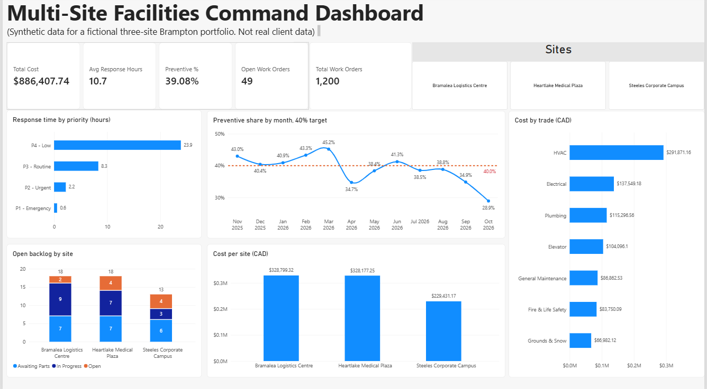
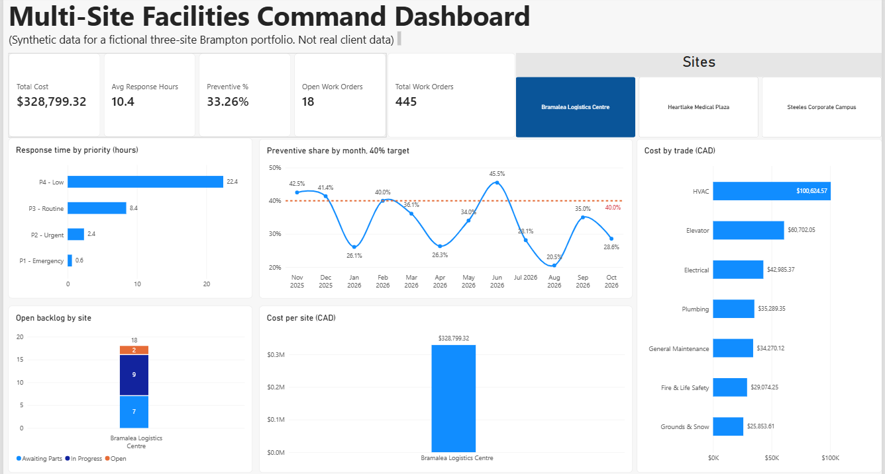
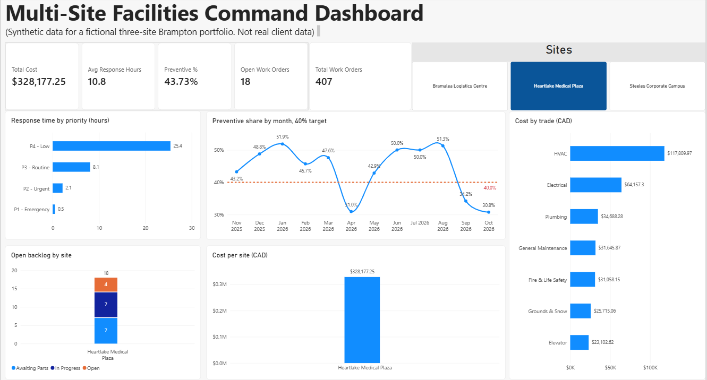
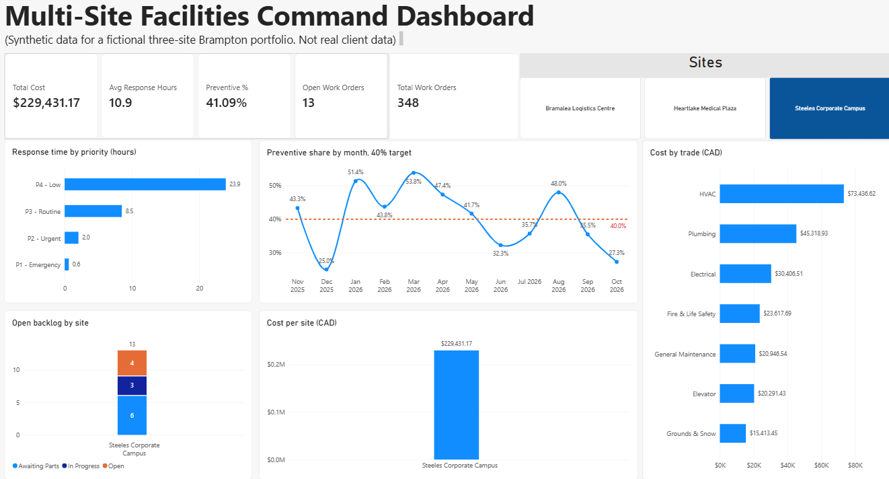

# Multi-Site Facilities Command Dashboard

A Power BI dashboard and monthly report for a fictional three-site portfolio in Brampton, Ontario. It shows how I turn work order data into budget and performance decisions for a facilities team.

> **Data disclosure:** All data is synthetic. The 1,200-row dataset was generated with Claude from a script with a fixed random seed, and the monthly commentary was drafted with Claude. I built the Power BI model and visuals myself and checked every figure against the CSV before publishing.

## What it answers

1. **Response time:** how quickly does each priority level get a first response?
2. **Backlog:** how many work orders are open at each site, and at what stage?
3. **Preventive versus reactive:** is planned maintenance holding at the 40% target?
4. **Cost:** which sites and which trades drive spend?

A site slicer filters every card and chart to one site.

### Bramalea Logistics Centre

### Heartlake Medical Plaza

### Steeles Corporate Campus

## Findings from the sample data

- Preventive share fell to 28.9% in October 2026, the lowest month of the year and well under the 40% target.
- Emergency (P1) requests get a first response in about 0.6 hours on average; low-priority (P4) requests take about 24 hours.
- 49 work orders are open, 8 of them emergency or urgent.
- HVAC is the largest cost line at about a third of total spend.

## Sites (fictional)

- Bramalea Logistics Centre
- Heartlake Medical Plaza
- Steeles Corporate Campus

## Files

| File | Purpose |
|---|---|
| `FacilitiesDashboard.pbix` | The Power BI file |
| `work_orders.csv` | 1,200 synthetic work orders, November 2025 to October 2026 |
| `dax_measures.md` | Every formula and visual, with verification totals |
| `monthly_facilities_report_Oct2026.md` | One-page monthly report written from the dashboard |
| `screenshots/` | Dashboard images |

## Data dictionary

| Column | Meaning |
|---|---|
| work_order_id | Unique ID |
| site | One of three fictional sites |
| date_opened / date_closed | Timestamps; closed is blank while the order is open |
| trade | HVAC, Electrical, Plumbing, General Maintenance, Fire & Life Safety, Elevator, Grounds & Snow |
| priority | P1 Emergency to P4 Low |
| work_type | Preventive or Reactive |
| status | Closed, Open, In Progress, Awaiting Parts |
| response_hours | Hours from request to first response |
| hours_to_close | Total hours to close; blank while open |
| cost_cad | Labour plus materials; open orders carry partial cost |

## Known limits

- Synthetic data has no real seasonality, vendor behaviour or warranty effects.
- Open orders carry about 30% of their expected cost, so recent months look cheaper than they will end up.
- Patterns come from the generating script, so the findings illustrate the method and are not real-world benchmarks.

## How to reproduce

1. Open Power BI Desktop and load `work_orders.csv`.
2. Follow `dax_measures.md` to build the date table, measures and visuals.
3. Check the cards against the verification table at the bottom of that file.

## Skills shown

Work order analysis, budget and cost reporting, KPI design, data modelling, DAX, data validation and responsible use of AI in analysis.
